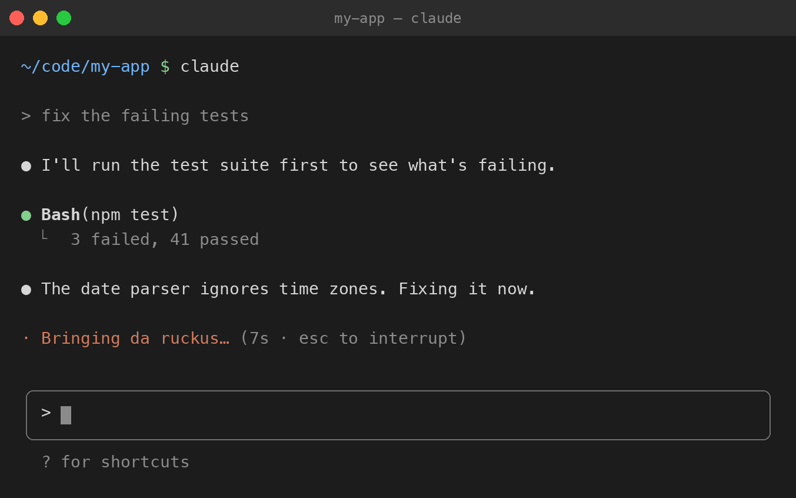

# 36 Spinners

Wu-Tang Clan spinner words for Claude Code. **[Project website](https://36-spinners.evan-roth.com)**



While Claude Code works, it shows a word next to the spinner: *Jogging…*, *Pondering…*. 36 Spinners swaps those words for Wu-Tang Clan song titles and lines: *Bombing atomically…*, *Protecting ya neck…*, *Forming like Voltron…*, *Seeing pink hearts, yellow moons…*

94 of them, mostly from *Enter the Wu-Tang (36 Chambers)*. See where each comes from in [SOURCES.md](SOURCES.md).

## Install

Paste this into Terminal:

```sh
curl -fsSL https://raw.githubusercontent.com/evanroth/wu-tang-spinner/main/install.sh | bash
```

Then start a new Claude Code session. Sessions that are already running keep their old words until you restart them.

The installer backs up `~/.claude/settings.json` (to `settings.json.backup-<date>`), then adds the word list to it. Your other settings stay as they are. It needs [`jq`](https://jqlang.org/), which comes with recent versions of macOS. On Linux: `sudo apt install jq`, or your package manager's equivalent.

### Mix with Claude's own words

By default you get only Wu-Tang words. To add them to Claude's usual words instead:

```sh
curl -fsSL https://raw.githubusercontent.com/evanroth/wu-tang-spinner/main/install.sh | bash -s -- --append
```

## Update

Run the install command again. It replaces the list with the latest one.

## Uninstall

```sh
curl -fsSL https://raw.githubusercontent.com/evanroth/wu-tang-spinner/main/uninstall.sh | bash
```

This removes the `spinnerVerbs` setting (after another backup), and Claude goes back to its default words.

## Do it by hand

It's one setting. Add this to `~/.claude/settings.json`, using the full list from [spinner-verbs.json](spinner-verbs.json):

```json
"spinnerVerbs": {
  "mode": "replace",
  "verbs": ["Bringing da ruckus", "Protecting ya neck", "Bombing atomically"]
}
```

`"replace"` uses only these words. `"append"` adds them to Claude's defaults.

Or paste the link to this repo into Claude Code and ask it to add the words for you.

## Notes

- Running the installer replaces any `spinnerVerbs` you already had, and uninstalling removes it. Both keep a backup.
- If you set `CLAUDE_CONFIG_DIR`, the scripts use the `settings.json` in that folder.
- Song titles and short phrases only, chosen as a fan. Left out: drug, violence and slur references.

## Changing the list

The list lives in `wu-tang-spinners.xlsx` (kept out of the repo). After editing it, run `python3 tools/export_verbs.py` to rewrite `spinner-verbs.json` and `SOURCES.md`, and `python3 tools/make_gif.py` to redraw the GIF. Both need `openpyxl`/`Pillow`; the GIF also needs macOS fonts and `ffmpeg`.

## License

Public domain ([CC0](LICENSE)). Do whatever you like with it. Wu-Tang Clan's songs belong to their writers; this is just a list of short phrases.
